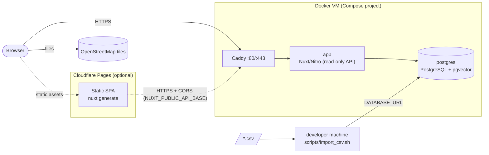
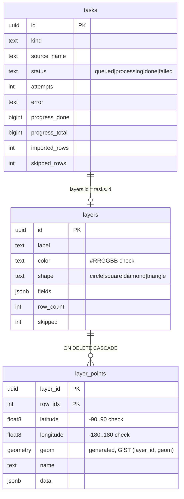

# Architecture

Layer Explorer is a map application: a browser SPA that shows point layers on a
Leaflet map. Some layers ship as static JSON; others are CSV files that the
server imports asynchronously into PostgreSQL and streams back to the browser.

This document describes the system as implemented in the working tree. Where the
code and other docs disagree, [Known gaps](#9-known-gaps-and-doc-drift) lists it.

## 1. System context

Two ways to serve the UI, selected at build time:

| Mode | Build | UI served from | API origin |
|---|---|---|---|
| Same origin (container image) | `nuxt build` | the `app` container (Nitro) | same origin, `apiBase = ''` |
| Split | `nuxt generate` | Cloudflare Pages | `NUXT_PUBLIC_API_BASE` = API HTTPS origin; API allows it via `CORS_ORIGINS` |

Browsers only talk to the API (and to the OSM tile server). They never reach
PostgreSQL.

## 2. Repository layout

| Path | Responsibility |
|---|---|
| `frontend/app/` | Vue 3 SPA (`ssr: false`): components, `useLayers` composable, types, layer parsing |
| `frontend/public/data/` | Built-in static layers (`layers.json` index + one JSON table per layer) |
| `frontend/server/` | Nitro server: read-only REST API, health routes, migrations runner, CSV import code used by the script |
| `frontend/tests/` | Vitest: layer parsing, static data, CSV parsing, import |
| `frontend/Dockerfile` | Builds the Nuxt project into the `app` image |
| `frontend/scripts/import-csv.ts` | CLI import (`npm run import -- <file.csv>`) |
| `frontend/scripts/geojson-to-csv.ts` | CLI GeoJSON to CSV converter (`utils/geojson.ts`) |
| `backend/docker/` | Compose topology (`compose.yaml`, `compose.vm.yaml`), `compose.sh` wrapper, `Caddyfile`, `.env.example` |
| `backend/services/database/` | `init/` (new-volume SQL), `migrations/` (forward-only), `SCHEMA.md` |
| `scripts/` | `deploy_frontend.sh` (Pages), `deploy_backend.sh` + `vm_activate.sh` (VM), `import_csv.sh` (CLI import), `start.sh` menu |
| `@docs/` | Single documentation directory: architecture, how-to-use, bootstrap, deployment, research notes and papers (`research/`), `JOURNAL.csv` |

## 3. Frontend

Nuxt 4 / Vue 3 SPA with Leaflet. Geist fonts and design tokens live in
`app/assets/css/tokens.css`.

- `app.vue` composes the shell: a side panel (`LayerPanel.vue`), the map
  (`MapView.client.vue`, client-only, OSM tiles) and a closeable point-details dialog
  on the right of the map (`PointForm.vue`). Selection is dropped when its layer is hidden.
- `composables/useLayers.ts` is the single data boundary. It:
  1. loads `layers.json` and each static layer table from `public/data/`;
  2. calls the API for server layers (`GET /api/layers`, `GET /api/layers/:id`
     summary), marking them `imported: true`. Their points are **not** loaded
     whole: `MapView` asks `/clusters` for the current viewport on every
     `moveend` (see §5a);
- `utils/layers.ts` validates every payload (shape, colour, coordinates) before
  it reaches the map; invalid layers surface as per-layer error states with retry.
- Each layer has a colour **and** a marker shape so state is not colour-only.

Per-layer states are `loading | error | ready`; the index has its own state; API
failures (`apiError`) are shown separately
so static layers keep working when the API is down.

## 4. API (Nitro, `frontend/server/`)

The API is part of the Nuxt project and runs in the same image as the UI. The
Compose `app` service serves it. The API is read-only (GET only);
import is a local script (§5).

| Route | Purpose |
|---|---|
| `GET /api/layers`, `GET /api/layers/:id` | Layer index / one layer's summary (`fields`, `skipped`, `rowCount`, `bounds`; no rows) |
| `GET /api/layers/:id/clusters?bbox&zoom` | Viewport points grouped into PostGIS grid cells |
| `GET /api/layers/:id/points?bbox` | Up to 50 individual points in a small box |
| `GET /api/layers/:id/points/:row` | Every column of one point |
| `GET /healthz`, `GET /readyz` | Liveness / readiness (`readyz` checks PostgreSQL) |

Cross-cutting behaviour:

- **Input safety**: ids must be UUIDs (`idParam`). Errors
  use `fail()`, whose message is client-safe.
- **CORS** (`middleware/cors.ts`): only for `/api/*`, only origins in
  `CORS_ORIGINS`, methods GET.
- **Startup** (`plugins/services.ts`): load config, wait for PostgreSQL, run
  migrations (skipped on Vercel). If config
  is missing, the API disables itself with a warning so `nuxt dev` still serves UI.
- **Shutdown**: a Nitro `close` hook closes the pool.
- **Connections** (`utils/services.ts`): lazily created, process-wide
  `pg.Pool` (max 8).
- **Logging**: structured logs through `utils/log.ts`.
- **No authentication** is implemented. The API is read-only, so nobody can
  write or delete through it, but anyone who can reach it can read all layers.
  See gaps.

## 5. CSV import (script)

Import runs outside the web app, so Vercel (or any web host) only presents and
filters data. `scripts/import_csv.sh <file.csv>` (or `npm run import -- <file.csv>`
in `frontend/`) runs `frontend/scripts/import-csv.ts` with `vite-node`:

1. resolve `DATABASE_URL` from the environment, else `backend/docker/.env`
   (`utils/cli.ts`; the password is masked in output);
2. validate the path (exists, regular file, `.csv`, not empty);
3. apply pending migrations (`utils/db.ts`);
4. `importCsvFile` (`utils/import.ts`): stream-scan the file (`analyze`), then in
   one transaction `DELETE` the layer with the same id, `INSERT` the layer and
   `INSERT` points in batches of 1000.

Design properties (AGENTS.md: idempotent, replay-safe, durable):

- **PostgreSQL is the system of record**; there is no queue or worker.
- **Idempotency**: the layer id is a UUIDv5 of the file name, so re-importing a
  file replaces its layer.
- **Atomic result**: layer and points commit together. A failure rolls back and
  the script exits non-zero; no partial layer remains.
- **CSV rules** (`utils/csv.ts`): header-based detection of latitude, longitude
  and name columns; rows with missing or out-of-range coordinates are counted as
  skipped; at most 500 columns; columns are keyed by position (`c<n>`) so
  headers like `id` or `lat` cannot collide.
- The `tasks` table (migrations `0001`/`0002`) is unused history.

## 5a. Viewport clustering

Large layers are never sent to the browser whole. `layer_points.geom` (PostGIS
point, generated from latitude/longitude, GiST index on `(layer_id, geom)`)
answers viewport queries; `/clusters` filters with `&&` and groups with
`ST_SnapToGrid` using cells about 56 px wide at the requested zoom, anchored at
(0, 0) so cells do not move while panning. One-point cells come back as points;
the rest carry `count` and `bounds`. The response is capped (1500 cells,
`truncated` flag). The client (`MapView`) refetches on `moveend` (debounced
150 ms, previous request aborted), renders cluster markers with a count, zooms
into a cluster on click, and, when zooming cannot split it (identical
coordinates), lists its points from `/points`. A selected point's columns load
on demand from `/points/:row`. Measured on a 120k-point layer: whole-world view
about 17 KB and ~120 ms instead of the former ~150 MB table; regional views about
6 ms in the database. Static layers in `public/data` still load whole.

## 6. Data model

Authoritative detail is in `backend/services/database/SCHEMA.md` and the
migrations. Summary:

- There is no foreign key from `layers` to `tasks`; the link is the shared id.
  Deleting a layer leaves the task row as history.
- **Migrations**: `0001` creates `import_jobs`, `layers`, `layer_points`; `0002`
  renames `import_jobs` to `tasks` and adds `kind` and progress columns (the table is no longer written); `0003`
  enables PostGIS and adds the generated `geom` column and its GiST index. They are
  applied by the app at startup (`utils/db.ts`), each in a transaction, recorded
  in `schema_migrations`, serialized with advisory lock `727001`. Migrations are
  immutable and forward-only. The directory is mounted read-only at
  `MIGRATIONS_DIR`.
- **PostGIS**: enabled by migration `0003`, which also adds the generated `geom` column and `layer_points_geom_idx` (see `SCHEMA.md`).
- **pgvector**: the extension is enabled by `init/001-enable-pgvector.sql`, which
  runs only on a new volume. No vector columns exist yet. When added, document
  model, dimension, metric/operator, index, lineage, refresh and deletion in
  `SCHEMA.md` and enforce the dimension in PostgreSQL. Do not move vectors to
  JSON.
- The PostgreSQL image defaults to `jlabrada/postgis-pgvector:0.1.0` (PostGIS plus
  pgvector) and is overridable with `POSTGRES_IMAGE`; any override must include both extensions. PostGIS is used for the viewport index and grid clustering only.

## 7. Runtime topology and deployment

### Compose services (`backend/docker/compose.yaml`)

| Service | Image | Notes |
|---|---|---|
| `app` | built from `frontend/` via `frontend/Dockerfile` | port bound to `127.0.0.1` locally; health check on `/readyz` |
| `postgres` | `${POSTGRES_IMAGE}` (default `jlabrada/postgis-pgvector:0.1.0`) | named volume `postgres_data`; `init/` mounted; `pg_isready` check |

Hardening on the app service: non-root `node` user, `read_only` root with
`/tmp` tmpfs, `cap_drop: ALL`, `no-new-privileges`, memory limits, graceful stop
periods. Sibling services are addressed by Compose DNS (`postgres`),
never `localhost`. The migrations directory is mounted read-only.

The Dockerfile is multi-stage: `npm ci` and `nuxt build` in a build stage, then
only `.output` is copied into a minimal `node:22-alpine` runtime.

### Entry point and configuration

`backend/docker/compose.sh` is the only Compose entry point. It fixes the project
name, loads `.env` (created from `.env.example` on first local use) and the
ignored `compose.local.yaml` override. Runtime settings:

| Variable | Meaning |
|---|---|
| `DATABASE_URL` | Required; internal DNS URL, or the remote database |
| `MIGRATIONS_DIR` | Container path, with a repo-relative fallback for dev |
| `CORS_ORIGINS` | Allowed browser origins |

### VM (`compose.vm.yaml` + scripts)

- `compose.vm.yaml` removes the `app` host port and adds Caddy on 80/443 with
  automatic HTTPS for `BACKEND_DOMAIN`. Caddy gzip/zstd-compresses JSON responses
  and reverse-proxies to `app`. Only Caddy is publicly exposed.
- `scripts/deploy_backend.sh` rsyncs `backend/` and `frontend/` (excluding
  `.env*`, `node_modules`, `.nuxt`, `.output`, local overrides) to a fresh
  `releases/<id>/`, then runs `scripts/vm_activate.sh` on the VM.
- `vm_activate.sh` takes a deploy lock, keeps the Compose project name fixed
  (refusing to switch it), keeps secrets in `shared/backend.env` (mode 600),
  builds on the VM, starts with `--wait`, checks the HTTPS health URL, and only
  then moves the `current` symlink. Volumes are never deleted. There is no
  automatic rollback and no zero-downtime guarantee (single VM).
- The VM holds no CSV files: data is imported from a developer machine with
  `scripts/import_csv.sh` against the database.
- `scripts/deploy_frontend.sh` uploads a static build to Cloudflare Pages
  (requires `nuxt generate` output and `NUXT_PUBLIC_API_BASE` at build time).

## 8. Quality and test setup

- Vitest in `frontend/` (`npm test`): `layers.test.ts`, `data.test.ts`
  (static layer contracts), `viewport.test.ts`, `tests/server/csv.test.ts`,
  `tests/server/import.test.ts`, `tests/server/cli.test.ts`, `tests/server/clusters.test.ts`, and a PostGIS
  integration test (`tests/server/points.integration.test.ts`, runs only when
  `TEST_DATABASE_URL` is set).
- `npm run typecheck` runs `nuxt typecheck`.
- Compose changes are validated with `./backend/docker/compose.sh config --quiet`.
- Not yet present: Gherkin acceptance tests, mutation tests, coverage and
  complexity gates, and a database-backed integration test for `importCsvFile`.
  AGENTS.md asks for these over time.

## 9. Known gaps and doc drift

1. ~~**API location**~~ Resolved: the API lives in `frontend/server/`,
   the image is defined by `frontend/Dockerfile`, and `AGENTS.md`, the READMEs and
   `@docs/` describe this.
2. **No authentication or authorization** on any route, including
   delete. Acceptable only on a trusted network; add auth before public exposure.
3. **Stale local `.env`**: files copied from an older `.env.example` may set
   `POSTGRES_IMAGE=pgvector/pgvector:pg16`, which lacks PostGIS and breaks
   migration `0003`. Update it to the current `.env.example` value.
4. **Layer styling** is chosen at import time from `count(layers) % 4`, so
   colours can repeat after deletions.
5. **Map tiles** come from the public OpenStreetMap tile server, an external
   runtime dependency that is not suited to heavy production traffic.
6. **No backups** are configured for PostgreSQL or the server env file.

## 10. Extension points

- Vector features: add a migration with a fixed-dimension `vector(n)` column and
  index, document it in `SCHEMA.md`, keep embeddings in PostgreSQL.
- New backend containers: follow `.agents/skills/add-backend-service`.
- UI work: follow `.agents/skills/edit-frontend` and the tokens in
  `app/assets/css/tokens.css`.
