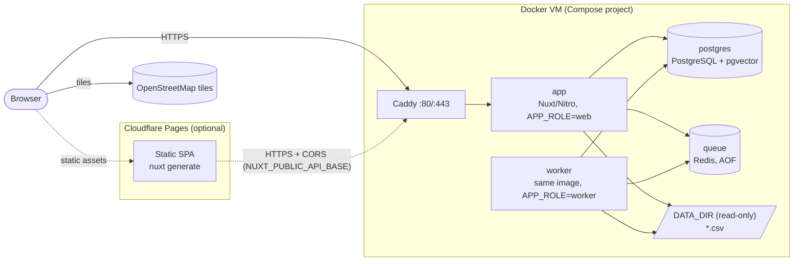
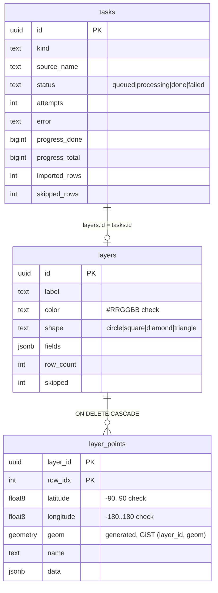

# Architecture

Layer Explorer is a map application: a browser SPA that shows point layers on a
Leaflet map. Some layers ship as static JSON; others are CSV files that the
server imports asynchronously into PostgreSQL and streams back to the browser.

This document describes the system as implemented in the working tree. Where the
code and other docs disagree, [Known gaps](#9-known-gaps-and-doc-drift) lists it.

## 1. System context



Two ways to serve the UI, selected at build time:

| Mode | Build | UI served from | API origin |
|---|---|---|---|
| Same origin (container image) | `nuxt build` | the `app` container (Nitro) | same origin, `apiBase = ''` |
| Split | `nuxt generate` | Cloudflare Pages | `NUXT_PUBLIC_API_BASE` = API HTTPS origin; API allows it via `CORS_ORIGINS` |

Browsers only talk to the API (and to the OSM tile server). They never reach
PostgreSQL or Redis.

## 2. Repository layout

| Path | Responsibility |
|---|---|
| `frontend/app/` | Vue 3 SPA (`ssr: false`): components, `useLayers` composable, types, layer parsing |
| `frontend/public/data/` | Built-in static layers (`layers.json` index + one JSON table per layer) |
| `frontend/server/` | Nitro server: REST API, SSE stream, health routes, migrations runner, import worker |
| `frontend/tests/` | Vitest: layer parsing, static data, CSV parsing, SSE hub |
| `frontend/Dockerfile` | Builds the Nuxt project into one image used by `app` and `worker` |
| `backend/docker/` | Compose topology (`compose.yaml`, `compose.vm.yaml`), `compose.sh` wrapper, `Caddyfile`, `.env.example` |
| `backend/services/database/` | `init/` (new-volume SQL), `migrations/` (forward-only), `SCHEMA.md` |
| `backend/services/queue/` | Redis notes |
| `data/` | Source CSV files offered for import |
| `scripts/` | `deploy_frontend.sh` (Pages), `deploy_backend.sh` + `vm_activate.sh` (VM), `start.sh` menu |
| `@docs/` | Single documentation directory: architecture, how-to-use, bootstrap, deployment, research notes and papers (`research/`), `JOURNAL.csv` |

## 3. Frontend

Nuxt 4 / Vue 3 SPA with Leaflet. Geist fonts and design tokens live in
`app/assets/css/tokens.css`.

- `app.vue` composes the shell: a side panel (`LayerPanel.vue`), the map
  (`MapView.client.vue`, client-only, OSM tiles) and a point detail form
  (`PointForm.vue`). Selection is dropped when its layer is hidden.
- `composables/useLayers.ts` is the single data boundary. It:
  1. loads `layers.json` and each static layer table from `public/data/`;
  2. calls the API for server layers (`GET /api/layers`, `GET /api/layers/:id`
     summary), marking them `imported: true`. Their points are **not** loaded
     whole: `MapView` asks `/clusters` for the current viewport on every
     `moveend` (see §5a);
  3. lists importable files (`GET /api/files`) and starts imports
     (`POST /api/imports`);
  4. opens `EventSource('/api/events')` and applies `snapshot`/`task` events,
     keeping the newest `updatedAt` per task. A task transitioning to `done`
     triggers a re-sync of server layers. A snapshot also re-syncs, which covers
     SSE reconnects;
  5. removes layers (`DELETE /api/layers/:id` for imported ones; built-in ones
     are only dropped from the session).
- `utils/layers.ts` validates every payload (shape, colour, coordinates) before
  it reaches the map; invalid layers surface as per-layer error states with retry.
- Each layer has a colour **and** a marker shape so state is not colour-only.

Per-layer states are `loading | error | ready`; the index has its own state; SSE
connectivity (`eventsOnline`) and API failures (`apiError`) are shown separately
so static layers keep working when the API is down.

## 4. API (Nitro, `frontend/server/`)

The API is part of the Nuxt project and runs in the same image as the UI. The
Compose `app` service sets `APP_ROLE=web`.

| Route | Purpose |
|---|---|
| `GET /api/files` | Lists regular, non-hidden `*.csv` files directly in `SOURCE_DIR` |
| `POST /api/imports` `{file}` | Validates the name against that listing, inserts a `tasks` row, enqueues a job, returns `202` + `Location: /api/tasks/:id` |
| `GET /api/tasks`, `GET /api/tasks/:id` | Task history (50 newest) / one task |
| `GET /api/layers`, `GET /api/layers/:id` | Layer index / one layer's summary (`fields`, `skipped`, `rowCount`, `bounds`; no rows) |
| `GET /api/layers/:id/clusters?bbox&zoom` | Viewport points grouped into PostGIS grid cells |
| `GET /api/layers/:id/points?bbox` | Up to 50 individual points in a small box |
| `GET /api/layers/:id/points/:row` | Every column of one point |
| `DELETE /api/layers/:id` | Deletes a layer (points cascade); task row stays as history |
| `GET /api/events` | Server-Sent Events: `snapshot` (20 newest tasks), then `task`, plus `ping` every 15 s |
| `GET /healthz`, `GET /readyz` | Liveness / readiness (`readyz` checks PostgreSQL and Redis) |

Cross-cutting behaviour:

- **Input safety**: ids must be UUIDs (`idParam`); import names must match an
  exact directory listing entry, so no path can be supplied by the client. Errors
  use `fail()`, whose message is client-safe.
- **CORS** (`middleware/cors.ts`): only for `/api/*`, only origins in
  `CORS_ORIGINS`, methods GET/POST/DELETE.
- **Startup** (`plugins/services.ts`): load config, wait for PostgreSQL, run
  migrations, then start the worker only when `APP_ROLE` is not `web`. If config
  is missing, the API disables itself with a warning so `nuxt dev` still serves UI.
- **Shutdown**: a Nitro `close` hook stops the worker, then closes the SSE hub,
  queue, Redis and pool.
- **Connections** (`utils/services.ts`): lazily created, process-wide
  `pg.Pool` (max 8), ioredis, BullMQ `Queue`, SSE hub.
- **Logging**: structured logs through `utils/log.ts`.
- **No authentication** is implemented. Anyone who can reach the API can start
  imports and delete layers. See gaps.

## 5. Asynchronous import pipeline

```mermaid
sequenceDiagram
  autonumber
  participant B as Browser
  participant A as app (web)
  participant P as PostgreSQL
  participant R as Redis
  participant W as worker

  B->>A: POST /api/imports {file}
  A->>P: INSERT tasks (queued)
  A->>R: BullMQ add (jobId = task id)
  A->>R: PUBLISH task-events
  A-->>B: 202 + task
  R-->>W: job
  W->>P: UPDATE tasks → processing (attempts+1)
  W->>R: PUBLISH progress
  W->>W: stream CSV (analyze, then points)
  W->>P: BEGIN; DELETE layer; INSERT layer; INSERT points in batches of 1000
  W->>P: UPDATE tasks → done; COMMIT
  W->>R: PUBLISH task-events
  R-->>A: message (SSE hub subscriber)
  A-->>B: SSE `task` event
  B->>A: GET /api/layers, /api/layers/:id (summary)
  B->>A: GET /api/layers/:id/clusters?bbox&zoom (per viewport)
```

Design properties (AGENTS.md: idempotent, retry-bounded, replay-safe, durable):

- **PostgreSQL is the system of record.** The `tasks` row is written before the
  job is enqueued. Redis carries delivery and progress notifications only.
- **Idempotency**: BullMQ `jobId = task id`, so a duplicate enqueue is a no-op.
  `layers.id = tasks.id`, so a replay deletes and rewrites the same layer. A task
  already `done` is skipped.
- **Atomic result**: layer, points and the `done` status are written in one
  transaction. A failed or crashed attempt leaves no partial layer.
- **Bounded retries**: `IMPORT_ATTEMPTS` (default 3) with exponential backoff
  (2 s base). File problems raise `ImportError` (an `UnrecoverableError`) and are
  not retried. On the final failure the task becomes `failed` with a user-safe
  message; unexpected errors get a generic message and details go to logs.
- **Lost-job recovery**: every 60 s the worker re-enqueues tasks still
  `queued`/`processing` and untouched for `IMPORT_STALE_SECONDS` (default 120).
  This covers a crash between insert and enqueue or a Redis flush. The same
  `jobId` makes it a no-op for jobs BullMQ still tracks.
- **Enqueue failure**: the API marks the task `failed` and returns `503`.
- **Single active import per file**: partial unique index on
  `tasks(source_name)` for active statuses; a violation returns `409`.
- **Backpressure**: worker concurrency 2; progress updates throttled to one per
  400 ms; SSE capped at 200 clients (`503` beyond that).
- **CSV rules** (`utils/csv.ts`): header-based detection of latitude, longitude
  and name columns; rows with missing or out-of-range coordinates are counted as
  skipped; at most 500 columns; columns are keyed by position (`c<n>`) so
  headers like `id` or `lat` cannot collide.
- **Liveness**: the worker touches `/tmp/heartbeat` every 10 s; its Compose
  health check fails if the file is older than 30 s.

## 5a. Viewport clustering

Large layers are never sent to the browser whole. `layer_points.geom` (PostGIS
point, generated from latitude/longitude, GiST index on `(layer_id, geom)`)
answers viewport queries; `/clusters` filters with `&&` and groups with
`ST_SnapToGrid` using cells about 56 px wide at the requested zoom, anchored at
(0, 0) so cells do not move while panning. One-point cells come back as points;
the rest carry `count` and `bounds`. The response is capped (1500 cells,
`truncated` flag). The client (`MapView`) refetches on `moveend` (debounced
150 ms, previous request aborted), renders cluster markers with a count, zooms
into a cluster on click, and, when zooming cannot split it (identical
coordinates), lists its points from `/points`. A selected point's columns load
on demand from `/points/:row`. Measured on a 120k-point layer: whole-world view
about 17 KB and ~120 ms instead of the former ~150 MB table; regional views about
6 ms in the database. Static layers in `public/data` still load whole.

## 6. Data model

Authoritative detail is in `backend/services/database/SCHEMA.md` and the
migrations. Summary:



- There is no foreign key from `layers` to `tasks`; the link is the shared id.
  Deleting a layer leaves the task row as history.
- **Migrations**: `0001` creates `import_jobs`, `layers`, `layer_points`; `0002`
  renames `import_jobs` to `tasks` and adds `kind` and progress columns; `0003`
  enables PostGIS and adds the generated `geom` column and its GiST index. They are
  applied by the app at startup (`utils/db.ts`), each in a transaction, recorded
  in `schema_migrations`, serialized with advisory lock `727001`. Migrations are
  immutable and forward-only. The directory is mounted read-only at
  `MIGRATIONS_DIR`.
- **PostGIS**: enabled by migration `0003`, which also adds the generated `geom` column and `layer_points_geom_idx` (see `SCHEMA.md`).
- **pgvector**: the extension is enabled by `init/001-enable-pgvector.sql`, which
  runs only on a new volume. No vector columns exist yet. When added, document
  model, dimension, metric/operator, index, lineage, refresh and deletion in
  `SCHEMA.md` and enforce the dimension in PostgreSQL. Do not move vectors to
  JSON or Redis.
- The PostgreSQL image defaults to `jlabrada/postgis-pgvector:0.1.0` (PostGIS plus
  pgvector) and is overridable with `POSTGRES_IMAGE`; any override must include both extensions. PostGIS is used for the viewport index and grid clustering only.

## 7. Runtime topology and deployment

### Compose services (`backend/docker/compose.yaml`)

| Service | Image | Notes |
|---|---|---|
| `app` | built from `frontend/` via `frontend/Dockerfile` | `APP_ROLE=web`; port bound to `127.0.0.1` locally; health check on `/readyz` |
| `worker` | same image | `APP_ROLE=worker`; heartbeat health check; 768 MB limit, 30 s grace |
| `postgres` | `${POSTGRES_IMAGE}` (default `jlabrada/postgis-pgvector:0.1.0`) | named volume `postgres_data`; `init/` mounted; `pg_isready` check |
| `queue` | `redis:7-alpine` | `--appendonly yes`; named volume `queue_data` |

Hardening on both app services: non-root `node` user, `read_only` root with
`/tmp` tmpfs, `cap_drop: ALL`, `no-new-privileges`, memory limits, graceful stop
periods. Sibling services are addressed by Compose DNS (`postgres`, `queue`),
never `localhost`. The data directory (`DATA_DIR`, default `../../data`) and the
migrations directory are mounted read-only.

The Dockerfile is multi-stage: `npm ci` and `nuxt build` in a build stage, then
only `.output` is copied into a minimal `node:22-alpine` runtime.

### Entry point and configuration

`backend/docker/compose.sh` is the only Compose entry point. It fixes the project
name, loads `.env` (created from `.env.example` on first local use) and the
ignored `compose.local.yaml` override. Runtime settings:

| Variable | Meaning |
|---|---|
| `DATABASE_URL`, `QUEUE_URL` | Required; internal DNS URLs |
| `APP_ROLE` | `web`, `worker` or `all` (default when unset, used by `nuxt dev`) |
| `SOURCE_DIR`, `MIGRATIONS_DIR` | Container paths, with repo-relative fallbacks for dev |
| `CORS_ORIGINS` | Allowed browser origins |
| `IMPORT_ATTEMPTS`, `IMPORT_STALE_SECONDS` | Retry bound / stale-task threshold |

### VM (`compose.vm.yaml` + scripts)

- `compose.vm.yaml` removes the `app` host port and adds Caddy on 80/443 with
  automatic HTTPS for `BACKEND_DOMAIN`. Caddy gzip/zstd-compresses JSON responses
  and reverse-proxies to `app`. Only Caddy is publicly exposed.
- `scripts/deploy_backend.sh` rsyncs `backend/` and `frontend/` (excluding
  `.env*`, `node_modules`, `.nuxt`, `.output`, local overrides) to a fresh
  `releases/<id>/`, then runs `scripts/vm_activate.sh` on the VM.
- `vm_activate.sh` takes a deploy lock, keeps the Compose project name fixed
  (refusing to switch it), keeps secrets in `shared/backend.env` (mode 600),
  builds on the VM, starts with `--wait`, checks the HTTPS health URL, and only
  then moves the `current` symlink. Volumes are never deleted. There is no
  automatic rollback and no zero-downtime guarantee (single VM).
- The VM does not contain the repo's `data/` directory: operators place CSVs in a
  persistent directory and set its absolute path as `DATA_DIR` in
  `shared/backend.env`.
- `scripts/deploy_frontend.sh` uploads a static build to Cloudflare Pages
  (requires `nuxt generate` output and `NUXT_PUBLIC_API_BASE` at build time).

## 8. Quality and test setup

- Vitest in `frontend/` (`npm test`): `layers.test.ts`, `data.test.ts`
  (static layer contracts), `viewport.test.ts`, `tests/server/csv.test.ts`,
  `tests/server/sse.test.ts`, `tests/server/clusters.test.ts`, and a PostGIS
  integration test (`tests/server/points.integration.test.ts`, runs only when
  `TEST_DATABASE_URL` is set).
- `npm run typecheck` runs `nuxt typecheck`.
- Compose changes are validated with `./backend/docker/compose.sh config --quiet`.
- Not yet present: Gherkin acceptance tests, mutation tests, coverage and
  complexity gates, and integration tests for the import/retry/stale-sweep paths.
  AGENTS.md asks for these over time.

## 9. Known gaps and doc drift

1. ~~**API location**~~ Resolved: the API and worker live in `frontend/server/`,
   the image is defined by `frontend/Dockerfile`, and `AGENTS.md`, the READMEs and
   `@docs/` describe this.
2. **No authentication or authorization** on any route, including import and
   delete. Acceptable only on a trusted network; add auth before public exposure.
3. **Stale local `.env`**: files copied from an older `.env.example` may set
   `POSTGRES_IMAGE=pgvector/pgvector:pg16`, which lacks PostGIS and breaks
   migration `0003`. Update it to the current `.env.example` value.
4. **`@docs/DEPLOYMENT.md`** still calls the API a placeholder and mentions an
   `api` service and a `docs/` layout that predate the `app`/`worker` split.
5. **Single-writer assumption**: one `worker` instance is expected. Scaling it
   is safe for correctness (idempotent jobs, transactional writes) but the stale
   sweep would run per instance.
6. **Layer styling** is chosen at import time from `count(layers) % 4`, so
   colours can repeat after deletions.
7. **Map tiles** come from the public OpenStreetMap tile server, an external
   runtime dependency that is not suited to heavy production traffic.
8. **No backups** are configured for PostgreSQL, Redis or the server env file.

## 10. Extension points

- New background task kinds: add a `kind` value to `tasks`, a queue/processor
  beside `utils/worker.ts`, and publish through `utils/events.ts` so SSE and the
  UI pick it up unchanged.
- Vector features: add a migration with a fixed-dimension `vector(n)` column and
  index, document it in `SCHEMA.md`, keep embeddings in PostgreSQL.
- New backend containers: follow `.agents/skills/add-backend-service`.
- UI work: follow `.agents/skills/edit-frontend` and the tokens in
  `app/assets/css/tokens.css`.
